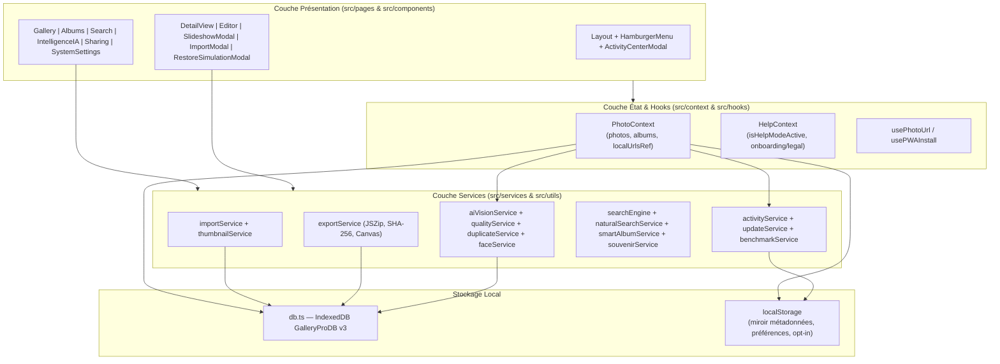
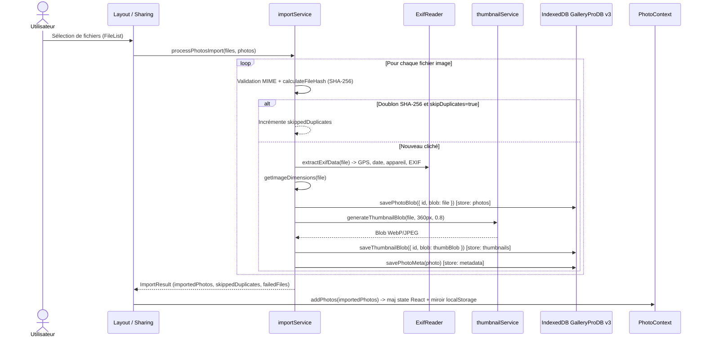
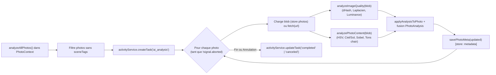
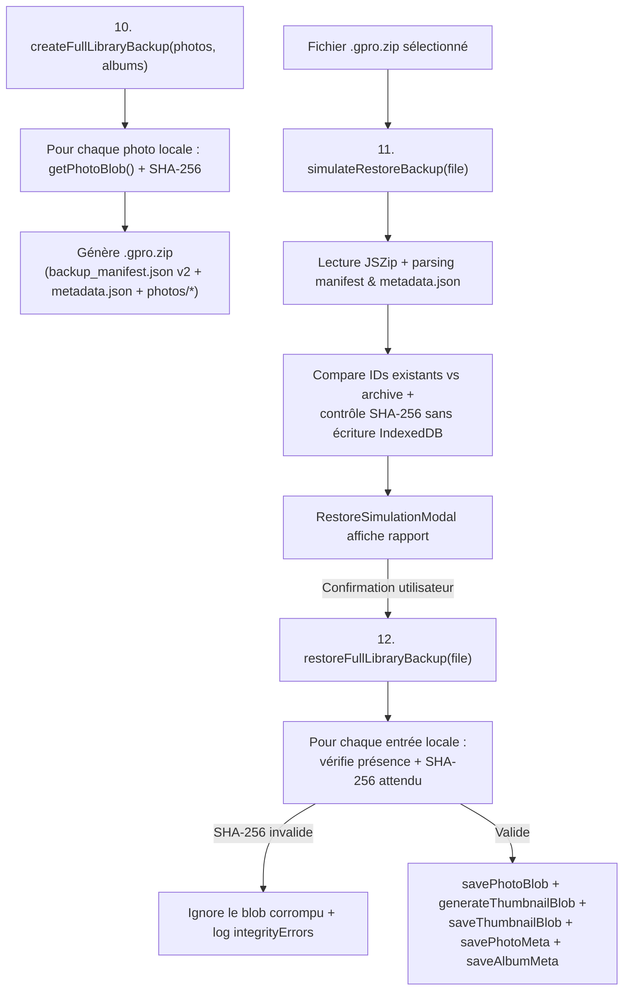

# Project Context: Gallery Pro (Photorapp) — v2.5.0

Documentation technique de référence pour les développeurs, contributeurs et agents d'ingénierie logicielle intervenant sur **Photorapp — Gallery Pro — Your Visual Legacy**.

---

## Sommaire

1. [Présentation générale](#1-présentation-générale)
2. [Architecture détaillée](#2-architecture-détaillée)
3. [Modèle de données et persistance IndexedDB](#3-modèle-de-données-et-persistance-indexeddb)
4. [Catalogue complet des services](#4-catalogue-complet-des-services)
5. [Parcours et flux de données](#5-parcours-et-flux-de-données)
6. [Intelligence photographique et algorithmes](#6-intelligence-photographique-et-algorithmes)
7. [Performance et traitements asynchrones](#7-performance-et-traitements-asynchrones)
8. [Tests et qualité](#8-tests-et-qualité)
9. [Conventions pour les futurs développements](#9-conventions-pour-les-futurs-développements)
10. [État actuel et points de vigilance](#10-état-actuel-et-points-de-vigilance)

---

## 1. Présentation générale

### Objectifs du projet

**Gallery Pro** est une Single Page Application (SPA) et Progressive Web App (PWA) écrite en **React 19 + TypeScript + Vite 8**, dédiée à l'organisation, l'exploration, la retouche non destructive et l'archivage de photothèques personnelles directement dans le navigateur.

### Principes architecturaux et Local-First

- **Stockage navigateur primaire :** La source de vérité est la base **IndexedDB** locale (`GalleryProDB`, version 3). Les fichiers binaires importés ne sont jamais téléversés vers un serveur applicatif.
- **Zéro backend requis :** Aucun serveur Node/API applicatif n'est nécessaire au fonctionnement courant (le build produit des fichiers statiques dans `dist/`, servis notamment via `netlify.toml`).
- **Immutabilité des originaux :** Les fichiers maîtres stockés dans IndexedDB ne sont jamais modifiés lors d'une retouche. Les ajustements sont stockés sous forme déclarative JSON (`PhotoAdjustments`) et appliqués au rendu CSS ou à l'export Canvas.
- **Portabilité vérifiable :** L'exportation `.gpro.zip` embarque un manifeste JSON v2 et les empreintes SHA-256 des blobs locaux.

### Contraintes de confidentialité et nuance réseau

- Aucune photo personnelle ni métadonnée privée ne quitte le navigateur lors des fonctions standards.
- Exceptions réseau documentées dans le code :
  - `index.html` charge les feuilles de style Google Fonts (`Inter` et `Material Symbols Outlined`).
  - `src/components/MapComponent.tsx` interroge les tuiles `https://{s}.tile.openstreetmap.org/{z}/{x}/{y}.png`.
  - `src/assets/data/mockData.ts` (3 photos initiales) et `src/pages/Albums.tsx` (image de repli) référencent des URLs distantes `lh3.googleusercontent.com` / `images.unsplash.com` tant que des clichés locaux ne les remplacent pas.
  - `src/utils/openrouter.ts` expose `fetchFreeModels()` appelant `https://openrouter.ai/api/v1/models` sur action explicite dans `/ia` (aucune image n'y est transmise).
  - `src/services/updateService.ts` effectue une requête `HEAD /?t=...` pour vérifier l'en-tête `ETag` en ligne.

---

## 2. Architecture détaillée

### Architecture React et routage (`src/App.tsx`)

L'application est encapsulée dans l'ordre suivant :
`PhotoProvider` → `HelpProvider` → `BrowserRouter` → `Layout` → `Routes`.

| Route | Composant page (`src/pages/`) | Responsabilité |
| :--- | :--- | :--- |
| `/` | `Gallery.tsx` | Mur chronologique, carrousel `SouvenirsCarousel`, sélection multiple, accès `DetailView` / `Editor` / `SlideshowModal` |
| `/albums` | `Albums.tsx` | Gestion des albums manuels et des albums intelligents (`SmartAlbumCriteria`) |
| `/albums/:id` | `AlbumDetail.tsx` | Contenu d'un album (statique ou évalué dynamiquement), changement de couverture, retrait de photos |
| `/ia` | `IntelligenceIA.tsx` | Lancement de l'analyse locale, revue flou/exposition, doublons exacts & `dHash`, carte GPS (`MapComponent` en lazy loading), regroupement personnes opt-in, config OpenRouter optionnelle |
| `/search` | `Search.tsx` | Recherche multicritère combinée et interprétation de requêtes naturelles |
| `/sharing` | `Sharing.tsx` | Importation par lot, export JSON/ZIP, sauvegarde intégrale `.gpro.zip`, simulation et restauration, diagnostic et réparation du stockage |
| `/settings` | `SystemSettings.tsx` | Version & mises à jour PWA/SW, mode novice, installation PWA, benchmark `1k`–`20k`, maintenance miniatures/orphelins |

### Contextes, Hooks et Modules transverses

- **`src/context/PhotoContext.tsx` (+ `photoContextDef.ts`, `usePhotos.ts`) :**
  - Maintient en mémoire `photos`, `albums`, `isLoading`, `migrationReport` et un registre `localUrlsRef` (`Record<string, string>`) cachant les `ObjectURL` par clé `id` (original) et `${id}_thumb` (miniature).
  - Révoque tous les `ObjectURL` créés au démontage.
  - Synchronise un miroir JSON dans `localStorage` (`gallery_pro_photos`, `gallery_pro_albums`) avec capture silencieuse d'erreur si le quota `localStorage` est dépassé (IndexedDB reste la source de vérité).
- **`src/context/HelpContext.tsx` (+ `helpContextDef.ts`, `useHelp.ts`) :**
  - Gère `isHelpModeActive` (mode novice / `HelpTooltip`), l'état d'ouverture et l'acceptation persistée des mentions légales (`OnboardingModal`).
- **`src/hooks/usePhotoUrl.ts` :**
  - Hook réactif `usePhotoUrl(photo, isThumbnail = false)`. Retourne directement `photo.url` si `storage === 'remote'` (ou absent), sinon appelle `getPhotoUrl(photo, isThumbnail)` pour résoudre un `ObjectURL` local.
- **`src/hooks/usePWAInstall.ts` :**
  - Intercepte `beforeinstallprompt` et `appinstalled`, détecte le mode `standalone` et identifie iOS Safari pour orienter `PWAInstallButton.tsx`.
- **`src/components/Layout.tsx` :**
  - Enveloppe globale : barre supérieure (`HamburgerMenu`, badge `ActivityCenterModal`, `PWAInstallButton`, raccourci import et aide), navigation inférieure mobile, déclenchement de `initBackgroundUpdateChecker()` et `OnboardingModal`.

### Schéma Mermaid des interactions principales

---

## 3. Modèle de données et persistance IndexedDB

> **Correction critique par rapport à l'ancienne documentation :** La version précédente de `CONTEXT.md` mentionnait à tort un store `blobs` ainsi qu'un stockage des photos dans `photos` et des paramètres dans `metadata`. Dans le code réel (`src/utils/db.ts`), le schéma **GalleryProDB v3** utilise les **6 object stores** ci-dessous.

### Schéma réel `GalleryProDB` (`DB_VERSION = 3` dans `src/utils/db.ts`)

| Object Store (`STORES.*`) | Rôle | Structure stockée | Clé primaire (`keyPath`) | Index secondaires |
| :--- | :--- | :--- | :--- | :--- |
| `photos` (`STORES.PHOTOS`) | Blobs binaires maîtres (originaux non modifiés) | `{ id: string, blob: Blob }` (`PhotoBlob`) | `id` | Aucun |
| `thumbnails` (`STORES.THUMBNAILS`) | Miniatures optimisées (`360px` max, WebP/JPEG) | `{ id: string, blob: Blob }` (`PhotoBlob`) | `id` | Aucun |
| `metadata` (`STORES.METADATA`) | Fiches descriptives des photographies | `Photo` (`src/types/types.ts`) | `id` | `date` (`unique: false`), `isFavorite` (`unique: false`) |
| `albums` (`STORES.ALBUMS`) | Définitions d'albums manuels et intelligents | `Album` (`src/types/types.ts`) | `id` | Aucun |
| `persons` (`STORES.PERSONS`) | Groupes de personnes (module opt-in `faceService`) | `PersonGroup` (`src/types/types.ts`) | `id` | Aucun |
| `settings` (`STORES.SETTINGS`) | Paramètres système et rapports techniques | `{ key: string, value: unknown }` | `key` | Aucun |

### Clés `localStorage` complémentaires

En parallèle d'IndexedDB, plusieurs clés `localStorage` sont utilisées :
- `gallery_pro_photos`, `gallery_pro_albums` : miroir JSON secondaire et source héritée pour la migration.
- `gallery_pro_faces_enabled` : drapeau opt-in (`'true'` / `'false'`) pour `faceService.ts`.
- `gallery_pro_auto_update_enabled`, `gallery_pro_last_update_check`, `gallery_pro_version`, `gallery_pro_app_etag` : état de `updateService.ts`.
- `openrouter_api_key` : clé API optionnelle saisie sur `/ia`.

### Types principaux (`src/types/types.ts`)

- **`Photo`** : `id`, `url`, `alt`, `date` (`YYYY-MM-DD`), `isFavorite`, `metadata?: PhotoMetadata`, `adjustments?: PhotoAdjustments`, `albumIds: string[]`, `tags: string[]`, `storage?: 'local' | 'remote'`, `personIds?: string[]`, `hasThumbnail?: boolean`, `createdAt?`, `updatedAt?`.
- **`PhotoMetadata`** : `device`, `resolution`, `width?`, `height?`, `date`, `location?`, `latitude?`, `longitude?`, `altitude?`, `fileSize?`, `mimeType?`, `hash?` (SHA-256), `exif?: PhotoExif`, `analysis?: PhotoAnalysis`.
- **`PhotoAnalysis`** : `qualityScore?` (`0–100`), `laplacianVariance?`, `isBlurry?`, `meanLuminance?`, `isUnderexposed?`, `isOverexposed?`, `dHash?` (16 hex / 64 bits), `dominantColors?`, `detectedFacesCount?`, `sceneTags?: PhotoSceneTag[]`, `autoKeywords?`, `analyzedAt?`.
- **`PhotoAdjustments`** : `brightness`, `contrast`, `saturation`, `exposure?`, `temperature?`, `tint?`, `highlights?`, `shadows?`, `vignette?`, `rotation?`, `aspectRatio?`, `filter?`, `cropRect?`.
- **`Album`** : `id`, `title`, `description?`, `coverPhotoId`, `photoCount`, `isShared`, `isPrivate`, `collaborators?`, `type?`, `isSmart?`, `smartCriteria?: SmartAlbumCriteria`, `createdAt?`, `updatedAt?`.
- **`PersonGroup`** : `id`, `name`, `coverPhotoId?`, `photoIds: string[]`, `faceBoundingBox?`, `createdAt`.
- **`StorageDiagnostic`** : `totalPhotos`, `localPhotosCount`, `remotePhotosCount`, `totalAlbums`, `totalSizeEstimatedBytes`, `orphanedBlobsCount`, `missingBlobsCount`, `thumbnailsCount?`, `missingThumbnailsCount?`, `indexedDbSupported`.

### Migrations, suppression atomique, nettoyage et gestion d'erreurs

- **Ouverture & compatibilité :** `openDB()` gère `onupgradeneeded` de façon incrémentale (création conditionnelle de chaque store via `db.objectStoreNames.contains(...)`) et réinitialise le handle singleton `dbInstance` sur `onversionchange`.
- **Migration idempotente (`migrateFromLocalStorage`) :**
  1. Lit les stores IndexedDB `metadata` et `albums` existants.
  2. Lit indépendamment `localStorage.getItem('gallery_pro_photos')` et `'gallery_pro_albums'`.
  3. N'injecte `fallbackPhotos` / `fallbackAlbums` que si **les deux sources** (IndexedDB et `localStorage`) sont vides pour un domaine donné.
  4. Fusionne par identifiant (`Set` d'IDs) sans jamais écraser les fiches existantes dans IndexedDB.
  5. Consigne un `MigrationReport` (`version: 2`, compteurs migrés/ignorés, erreurs) dans le store `settings` sous la clé `'migration_v2_report'`.
  6. Ne supprime pas les anciennes entrées `localStorage`.
- **Suppression atomique (`deletePhotoAtomic`, `deletePhotosAtomic`) :**
  1. Calcule les albums impactés : retire les IDs supprimés de `album.photoIds` (via `metadata`), met à jour `photoCount`, réassigne `coverPhotoId` à une autre photo encore présente dans l'album ou le vide (`''`).
  2. Exécute une transaction IndexedDB unique `'readwrite'` sur `[STORES.METADATA, STORES.ALBUMS]`.
  3. Une fois la transaction validée, supprime les blobs maîtres et miniatures correspondants en mode *best effort* (erreur loggée sans annuler la suppression métadonnée).
- **Intégrité & diagnostic :** `diagnoseStorage()` compare les clés des stores `photos` et `thumbnails` avec les photos `storage === 'local'`, puis `cleanupOrphanedBlobs()` et `cleanupOrphanedThumbnails()` suppriment les blobs orphelins.

---

## 4. Catalogue complet des services

| Fichier | Responsabilité | Fonctions / exports publics | Dépendances | Données manipulées & effets de bord | Limites connues |
| :--- | :--- | :--- | :--- | :--- | :--- |
| `src/utils/db.ts` | Couche d'accès IndexedDB v3, migration, suppression atomique, diagnostic | `STORES`, `openDB`, `setDBInstance`, `savePhotoBlob`, `getPhotoBlob`, `deletePhotoBlob`, `saveThumbnailBlob`, `getThumbnailBlob`, `deleteThumbnailBlob`, `savePhotoMeta`, `getAllPhotosMeta`, `saveAllPhotosMeta`, `deletePhotoMeta`, `saveAlbumMeta`, `getAllAlbumsMeta`, `saveAllAlbumsMeta`, `deleteAlbumMeta`, `savePerson`, `getAllPersons`, `deletePerson`, `saveSetting`, `getSetting`, `deletePhotoAtomic`, `deletePhotosAtomic`, `migrateFromLocalStorage`, `diagnoseStorage`, `cleanupOrphanedBlobs`, `cleanupOrphanedThumbnails` | IndexedDB navigateur, `localStorage`, `navigator.storage` | Lecture/écriture dans les 6 stores ; écrit `migration_v2_report` dans `settings` | Gestion `getAllBlobIds` via curseur/`getAllKeys` ; pas de transaction englobant `photos`+`thumbnails`+`metadata` simultanément lors du cleanup |
| `src/services/importService.ts` | Ingestion par lot, validation MIME, SHA-256, EXIF/GPS, miniature et persistance | `calculateFileHash`, `extractExifData`, `processPhotosImport` | `exifreader`, `crypto.subtle`, `db.ts`, `thumbnailService` | Écrit `photos`, `thumbnails`, `metadata` dans IndexedDB ; rejette doublons SHA-256 si `skipDuplicates` | Décodage image via DOM (`new Image()`) : formats non décodés nativement par le navigateur ont dimensions `0×0` |
| `src/services/thumbnailService.ts` | Génération et régénération de miniatures WebP/JPEG `360px` | `generateThumbnailBlob`, `getOrCreateThumbnailBlob`, `regenerateAllMissingThumbnails` | `createImageBitmap`, `OffscreenCanvas`, Canvas 2D, `db.ts` | Lit `photos`, lit/écrit `thumbnails` | S'exécute sur le thread principal (pas de Web Worker) ; `regenerateAllMissingThumbnails` ne remonte pas vers `activityService` |
| `src/services/exportService.ts` | Rendu Canvas retouché, export unitaire/ZIP, sauvegarde `.gpro.zip`, simulation & restauration | `triggerDownload`, `renderAdjustedPhotoBlob`, `exportSinglePhoto`, `exportPhotosToZip`, `exportMetadataJson`, `createFullLibraryBackup`, `simulateRestoreBackup`, `restoreFullLibraryBackup` | `jszip`, `crypto.subtle`, Canvas 2D, `db.ts`, `thumbnailService` | Génère téléchargements ; `restoreFullLibraryBackup` écrit dans `photos`, `thumbnails`, `metadata`, `albums` | `renderAdjustedPhotoBlob` ignore `tint`, `highlights` et `shadows` ; restauration séquentielle sans rollback transactionnel global et écrase les IDs existants |
| `src/services/aiVisionService.ts` | Classification heuristique locale de scènes, palette et enrichissement | `analyzePhotoContent`, `applyAnalysisToPhoto` | Canvas 2D (`getImageData`) | Produit `sceneTags`, `autoKeywords`, `dominantColors`, `detectedFacesCount` (sans effet réseau) | Heuristiques colorimétriques/spatiales uniquement (aucun modèle ML) ; détection de visages déduite du ratio de tons chair centraux |
| `src/services/qualityService.ts` | Évaluation netteté (Laplacien), exposition et empreinte perceptuelle `dHash` | `analyzeImageQuality` | Canvas 2D | Retourne `PhotoAnalysis` (`qualityScore`, `laplacianVariance`, `isBlurry`, `meanLuminance`, `dHash`) | Variance `< 120` sensible aux bokehs artistiques ; calcul sur image réduite `200px` de large |
| `src/services/duplicateService.ts` | Détection de doublons exacts et visuellement similaires | `getDHashDistance`, `findExactDuplicates`, `findSimilarPhotos`, `getUnverifiedPhotos` | Aucune externe | Lecture seule sur `Photo[]` | `findSimilarPhotos` est en complexité quadratique `O(n²)` et nécessite une analyse préalable (`dHash`) |
| `src/services/searchEngine.ts` | Extraction de facettes dynamiques et filtrage multicritère unifié | `extractAvailableFilters`, `filterPhotos`, `smartSearchPhotos` | `naturalSearchService` | Lecture seule sur `Photo[]` et `Album[]` | Filtrage linéaire en RAM ; `minQuality` utilise `75` par défaut pour les photos non analysées |
| `src/services/naturalSearchService.ts` | Analyseur lexical de requêtes naturelles FR/EN | `parseNaturalLanguageQuery` | Types `SearchFilters` | Retourne `ParsedNaturalQuery` (`extractedFilters`, `semanticTags`, `inferredSeason`, `inferredCategory`) | Dictionnaire statique (17 concepts) ; saison mappée sur un seul mois (`months[1]`) ; pas d'analyse morphologique ou couleurs |
| `src/services/smartAlbumService.ts` | Validation et évaluation dynamique d'albums intelligents | `isCriteriaValid`, `evaluateSmartAlbum`, `getSmartAlbumPhotos` | Types `Photo`, `SmartAlbumCriteria` | Lecture seule ; évalue les 9 champs de critères | Critères combinés uniquement en `ET` logique (pas de `OU` complexe) |
| `src/services/souvenirService.ts` | Génération rétrospective de souvenirs sur données réelles | `generateSouvenirs` | `Intl.DateTimeFormat('fr-FR')` | Lecture seule sur `Photo[]` ; exclut `'Lieu inconnu'` | Dépend de l'exactitude des dates `YYYY-MM-DD` et champs `location` |
| `src/services/faceService.ts` | Regroupement opt-in de portraits et purge irréversible | `isFaceGroupingEnabled`, `setFaceGroupingEnabled`, `getSavedPersonGroups`, `updatePersonGroupName`, `removePersonGroup`, `clusterPhotosIntoPersonGroups`, `clearAllFaceData` | `db.ts`, `localStorage` | Lit/écrit/purge store `persons` ; écrit clé `gallery_pro_faces_enabled` | Regroupe séquentiellement les portraits non assignés par paquets de `4` sans reconnaissance d'identité ni coordonnées faciales réelles |
| `src/services/activityService.ts` | Bus d'état pub/sub des tâches longues et annulation | `activityService` (singleton : `subscribe`, `createTask`, `updateTask`, `cancelTask`, `getAbortSignal`, `getRecentTasks`, `clearCompletedTasks`) | `AbortController` | Stocke jusqu'à 20 `ActivityTask` en RAM | Seul `analyzeAllPhotos` (`PhotoContext.tsx`) crée des tâches dans ce service ; import, export et maintenance ne l'utilisent pas encore |
| `src/services/benchmarkService.ts` | Suite de tests de charge synthétiques en mémoire | `generateSyntheticPhotoDataset`, `runScaleBenchmark`, `runFullBenchmarkSuite` | `performance.now()`, `searchEngine` | Alloue et trie jusqu'à 20 000 fiches `Photo` (`storage: 'remote'`) en RAM | Ne teste ni IndexedDB, ni décodage d'images, ni scroll DOM |
| `src/services/updateService.ts` | Gestion de version, vérification SW/ETag, mise à jour forcée et timer de fond | `APP_VERSION`, `APP_RELEASE_DATE`, `getUpdateStatus`, `subscribeToUpdates`, `setAutoUpdateEnabled`, `checkForUpdates`, `forceAppUpdate`, `initBackgroundUpdateChecker` | `navigator.serviceWorker`, `caches`, `fetch`, `localStorage` | Interroge SW et `HEAD /?t=...` ; `forceAppUpdate` purge `CacheStorage` et recharge la page | Intervalle fixe 15 min ; la détection repose sur l'état SW (`waiting`/`installing`) ou changement d'ETag HTTP |
| `src/utils/openrouter.ts` | Connecteur optionnel de découverte de modèles gratuits OpenRouter | `fetchFreeModels` | `fetch` (`https://openrouter.ai/api/v1/models`) | Retourne la liste `AIModel[]` filtrée sur `:free` | Aucune requête d'inférence vision/chat n'est implémentée dans l'application |

---

## 5. Parcours et flux de données

### Flux 1 à 4 : Importation, EXIF, Miniature et Persistance des originaux

### Flux 5 : Consultation dans la galerie

1. `Gallery.tsx` lit `photos` depuis `PhotoContext`, génère les souvenirs via `generateSouvenirs(photos)`, groupe les photos par `photo.date` décroissante et passe chaque groupe à `PhotoGrid`.
2. `PhotoGrid` rend directement les groupes `<= 48` photos, ou active la virtualisation par lignes (`OVERSCAN = 3`) au-delà.
3. Chaque `PhotoItem` appelle `usePhotoUrl(photo, true)` (`isThumbnail = true`) :
   - Si `localUrlsRef.current['${id}_thumb']` existe, l'URL en mémoire est retournée immédiatement.
   - Sinon `getOrCreateThumbnailBlob(photo)` lit `thumbnails`, ou régénère depuis `photos` si absente, puis crée et mémorise `URL.createObjectURL`.
4. Au clic sur une photo, `DetailView.tsx` utilise `usePhotoUrl(photo, false)` pour charger l'original pleine résolution.

### Flux 6 : Modification dans l'éditeur

1. `Editor.tsx` initialise un état local depuis `photo.adjustments` (ou valeurs neutres).
2. Les curseurs mettent à jour l'aperçu CSS temps réel (`filter` et `transform` + `clipPath` pour les marges de recadrage).
3. À l'enregistrement (`handleSave`), `updateAdjustments(photo.id, adjustments)` met à jour le tableau `photos` en contexte et persiste la fiche dans `metadata` (`savePhotoMeta`). Le blob dans `photos` reste inchangé.
4. À l'export (`handleExportEdited`), `renderAdjustedPhotoBlob` lit le blob maître, applique recadrage, rotation, `brightness`, `contrast`, `saturation`, filtre et `temperature` + `vignette` sur Canvas 2D, puis déclenche le téléchargement JPEG (`0.92`).

### Flux 7 : Recherche

1. `Search.tsx` capture la saisie libre et les filtres sélectionnés (année, mois, album, favoris, GPS, flou, appareil, lieu, qualité min).
2. `smartSearchPhotos(photos, rawQuery, baseFilters, albums)` appelle `parseNaturalLanguageQuery(rawQuery)` pour extraire `year`, `month`, `isFavorite`, `isBlurry`, `hasGps`, `semanticTags` et mots résiduels `query`.
3. `filterPhotos` combine les filtres manuels et extraits (les filtres extraits écrasent les clés correspondantes de `baseFilters` via spread `{ ...baseFilters, ...parsed.extractedFilters }`) et retourne les résultats + badges explicatifs.

### Flux 8 : Analyse photographique

### Flux 9 : Création d'un album intelligent

1. Sur `/albums`, l'utilisateur active le mode « Album Intelligent » et choisit un ou plusieurs critères (`SmartAlbumCriteria`).
2. `isCriteriaValid(criteria)` vérifie qu'au moins un critère actif est renseigné.
3. `createAlbum(..., { isSmart: true, smartCriteria })` enregistre l'album dans le store `albums`.
4. Dans `Albums.tsx` et `AlbumDetail.tsx`, `getSmartAlbumPhotos(photos, album.smartCriteria)` recalcule dynamiquement les clichés correspondants à chaque rendu mémorisé (`useMemo`).

### Flux 10 à 12 : Sauvegarde complète, Simulation et Restauration effective

### Flux 13 : Nettoyage et réparation du stockage

1. `diagnoseStorage(photos, albums)` inspecte les clés de `photos` et `thumbnails` pour compter orphelins et manquants, plus `navigator.storage.estimate()`.
2. `regenerateAllMissingThumbnails(photos)` parcourt les photos locales dépourvues d'entrée dans `thumbnails`, relit le blob maître dans `photos`, génère la miniature et l'enregistre.
3. `cleanupOrphanedBlobs(activeIds)` et `cleanupOrphanedThumbnails(activeIds)` suppriment toute clé de `photos` ou `thumbnails` absente des `Photo` actives.

---

## 6. Intelligence photographique et algorithmes

Le tableau suivant distingue strictement les techniques réellement implémentées afin d'éviter toute ambiguïté :

| Domaine | Algorithme / Méthode réelle | Données calculées & seuils | Stockage & Suppression | Ce que cela n'est PAS |
| :--- | :--- | :--- | :--- | :--- |
| **Netteté & Exposition** (`qualityService.ts`) | Traitement d'image classique : niveau de gris `0.299R + 0.587G + 0.114B`, noyau Laplacien discret 3×3 (`[0,1,0 / 1,-4,1 / 0,1,0]`) sur largeur `200px` | `laplacianVariance` (`isBlurry` si `< 120`), `meanLuminance` (`< 35` sous-exposé, `> 225` surexposé), `qualityScore` (`5–100`) | Dans `photo.metadata.analysis` (store `metadata`) ; réécrit lors d'une nouvelle analyse | Pas d'évaluation esthétique IA ni de détection de sujet principal |
| **Similitude visuelle** (`qualityService.ts`, `duplicateService.ts`) | Empreinte perceptuelle `dHash` 64 bits : redimensionnement `9×8`, comparaison gradient horizontal `G(x) > G(x+1)` | Chaîne hexadécimale 16 caractères `dHash` ; distance de Hamming `<= 6` pour grouper les rafales | `photo.metadata.analysis.dHash` ; comparé en mémoire dans `findSimilarPhotos` | Pas d'embeddings CLIP/SIFT |
| **Classification de scènes** (`aiVisionService.ts`) | Heuristiques déterministes sur Canvas `180px` : buckets RGB quantifiés par pas de 32, ratios HSV (chaud/vert/bleu), tiers haut/bas, différences finies type Sobel (`dx`, `dy`), seuils RGB/HSV de tons chair au centre (`25–75%` X, `20–80%` Y) | `dominantColors` (max 5), `sceneTags` avec confiance calculée, `autoKeywords`, `detectedFacesCount` (`0`, `1` si `skinRatio > 0.14`, `2` si `> 0.30`) | `photo.metadata.analysis` + fusion dans `photo.tags` ; modifiable ou supprimable avec la fiche photo | **Aucun** modèle ML/CNN/TensorFlow/ONNX/WebGPU |
| **Recherche naturelle** (`naturalSearchService.ts`) | Tokenisation, liste de mots vides FR, correspondance par sous-chaînes et dictionnaire statique `SCENE_SYNONYMS` (17 entrées) | `year` (`1990–2040`), `month` (mois central `months[1]` de la saison), drapeaux booléens, `semanticTags`, mots résiduels | Éphémère en mémoire lors de la recherche | Pas de NLP statistique, lemmatisation ni recherche sémantique vectorielle |
| **Regroupement des personnes** (`faceService.ts`) | Opt-in + filtrage des photos déjà marquées `portrait` ou `detectedFacesCount > 0`, découpage séquentiel en groupes de `CHUNK_SIZE = 4` | `PersonGroup` (`Personne 1`, `Personne 2`..., `coverPhotoId`, `photoIds`) | Store IndexedDB `persons` + flag `localStorage` `gallery_pro_faces_enabled` ; purge totale irréversible via `clearAllFaceData()` | **Aucune** détection de visage (boîte englobante), **aucune** biométrie ni reconnaissance d'identité d'une photo à l'autre |

---

## 7. Performance et traitements asynchrones

- **Stratégie de miniatures :** Réduction jusqu'à `360px` en WebP (`0.8`) dès l'import (`importService.ts`) ou à la demande (`getOrCreateThumbnailBlob`). Évite le décodage des images pleine définition dans la grille.
- **Virtualisation (`PhotoGrid.tsx`) :**
  - Seuil d'activation : `photos.length > 48 && !featured`.
  - Calcul dynamique du nombre de colonnes (`3` mobile, `6` tablette `>= 768px`, `8` desktop `>= 1024px`).
  - Hauteur estimée de ligne `Math.floor(containerWidth / cols) + 2`.
  - Écouteur `scroll` passif synchronisé sur `window.requestAnimationFrame` avec `OVERSCAN = 3` lignes avant et après la fenêtre visible.
- **Gestion mémoire des blobs :** Cache d'`ObjectURL` séparé (`id` vs `${id}_thumb`) dans `PhotoContext` (`localUrlsRef`), révoqué lors du démontage du provider.
- **Web Workers :** **Aucun Web Worker n'est actuellement utilisé dans l'application.** La mention de performances « hors thread principal » dans `thumbnailService.ts` fait uniquement référence à l'API navigateur `createImageBitmap` / `OffscreenCanvas`, appelée depuis le thread principal de l'UI.
- **File d'activité (`activityService.ts`) :** Singleton en mémoire (max 20 tâches) basé sur `AbortController`. **État actuel :** seul `analyzeAllPhotos` (`type: 'ai_analysis'`) crée et met à jour des tâches annulables ; les types `import`, `backup`, `restore`, `thumbnail_generation`, `duplicate_scan` et `benchmark` sont typés dans `ActivityType` mais ne sont pas encore raccordés.
- **Benchmark (`benchmarkService.ts`) :** Mesure uniquement des opérations CPU/RAM sur des tableaux synthétiques en mémoire (`storage: 'remote'`) aux paliers `1 000`, `5 000`, `10 000` et `20 000`. Il ne reflète pas les temps d'accès disque IndexedDB ni les FPS de défilement réel des images.

---

## 8. Tests et qualité

### Frameworks et commandes

- **Runner & DOM virtuel :** `vitest` (`4.1.8`) avec environnement `jsdom` (`29.1.1`), configuration dans `vite.config.ts` et setup dans `src/vitest-setup.ts`.
- **Utilitaires de test :** `@testing-library/react` (`16.3.2`), `@testing-library/jest-dom` (`6.9.1`).
- **Commandes vérifiées (`package.json`) :**
  - `npm run test -- --run` : exécute l'ensemble des suites Vitest.
  - `npm run lint` : exécute `eslint .`.
  - `npm run build` : vérifie TypeScript (`tsc -b`) et produit `dist/` (`vite build`).

### Couverture existante (12 fichiers de test)

| Catégorie | Fichiers présents | Scénarios couverts |
| :--- | :--- | :--- |
| **Persistance & Contexte** | `src/utils/db.test.ts`, `src/context/PhotoContext.test.tsx` | Ouverture/mocks IndexedDB, migration idempotente `LocalStorage → IndexedDB`, suppression atomique et synchronisation des couvertures d'albums |
| **Sauvegarde & Export** | `src/services/exportService.test.ts` | Génération de sauvegarde `.gpro.zip` avec manifeste v2, simulation de restauration, détection de corruption SHA-256 |
| **Recherche & Albums intelligents** | `src/services/searchEngine.test.ts`, `src/services/naturalSearchService.test.ts`, `src/services/smartAlbumService.test.ts` | Filtrage multicritère, parsing FR/EN (saisons, années, concepts), validation et évaluation des `SmartAlbumCriteria` |
| **Intelligence, Souvenirs, Doublons & Charge** | `src/services/aiVisionService.test.ts`, `src/services/souvenirService.test.ts`, `src/services/duplicateService.test.ts`, `src/services/benchmarkService.test.ts` | Enrichissement de tags et Canvas mocké, souvenirs par dates/lieux réels, distance `dHash` / doublons SHA-256, exécution du benchmark |
| **Composants UI** | `src/components/Editor.test.tsx`, `src/components/SlideshowModal.test.tsx` | Contrôles de l'éditeur non destructif et navigation du diaporama |

### Limites des tests et couverture souhaitable

- **Absence de tests E2E navigateur :** Aucun test Playwright/Cypress sur de vrais blobs IndexedDB, PWA/Service Worker ou rendu Canvas réel (`jsdom` mocke Canvas et IndexedDB).
- **Modules sans suite dédiée :** `importService.ts`, `thumbnailService.ts`, `qualityService.ts`, `faceService.ts`, `activityService.ts`, `updateService.ts`, `openrouter.ts`, `MapComponent.tsx`, `Layout.tsx`, `HamburgerMenu.tsx` et les pages (`Gallery`, `Albums`, `Sharing`, `Search`, `IntelligenceIA`, `SystemSettings`).

---

## 9. Conventions pour les futurs développements

1. **Préserver les originaux :** Ne jamais écraser les entrées du store `photos` lors d'une retouche ou d'une analyse ; toute édition visuelle doit rester déclarative dans `photo.adjustments`.
2. **Sécuriser toute opération de suppression ou restauration :** Toujours maintenir la cohérence référentielle entre `metadata` et `albums` (y compris `coverPhotoId`) via transactions IndexedDB atomiques.
3. **Préserver l'architecture Local-First :** Ne pas introduire de backend obligatoire, d'authentification imposée ou de dépendance payante.
4. **Consentement explicite avant tout envoi réseau :** Aucune photo ou métadonnée personnelle ne doit être transmise à un service externe (y compris via OpenRouter) sans action explicite et informée de l'utilisateur.
5. **Gérer les quotas et indisponibilités IndexedDB :** Toujours encadrer les accès `localStorage` (miroir susceptible de dépasser le quota) et IndexedDB avec des blocs `try/catch` et conserver la compatibilité de schéma via `onupgradeneeded`.
6. **Maintenir la compatibilité PWA :** Vérifier que toute nouvelle ressource critique ou route reste compatible avec `vite-plugin-pwa` et `netlify.toml`.
7. **Tester les services critiques :** Tout ajout ou modification sur `db.ts`, `importService.ts`, `exportService.ts`, `searchEngine.ts` ou `smartAlbumService.ts` doit être accompagné de tests unitaires Vitest.

---

## 10. État actuel et points de vigilance

- **Version documentée :** `2.5.0` (`13 Novembre 2026` dans `updateService.ts`), tandis que `package.json` reste à `"version": "0.0.0"`. Aucun fichier `LICENSE` n'est présent dans le dépôt.
- **Dette technique identifiée :**
  1. **Parité de rendu des retouches :** `highlights` et `shadows` existent dans `PhotoAdjustments` et `Editor.tsx` sans traitement pixel actif ; `tint` est appliqué dans `Editor.tsx` mais pas dans `renderAdjustedPhotoBlob` (`exportService.ts`) ; `DetailView.tsx` et `SlideshowModal.tsx` n'appliquent pas `temperature`, `tint`, `vignette` ni `cropRect`.
  2. **Raccordement partiel d'`activityService` :** Seul `analyzeAllPhotos` alimente la file d'activité et exploite `AbortController`.
  3. **Restauration sans rollback global :** `restoreFullLibraryBackup` écrit séquentiellement et écrase les identifiants déjà présents en base ; un échec en cours de restauration laisse les écritures déjà effectuées.
  4. **Dépendances réseau résiduelles :** Polices/icônes Google Fonts dans `index.html`, tuiles OSM dans `MapComponent.tsx` et URLs de démonstration dans `mockData.ts` / `Albums.tsx`.
  5. **Performances sur le thread principal :** Absence de Web Workers pour le hachage SHA-256, la génération de miniatures WebP, `qualityService` et `aiVisionService` (risque de saccades UI lors d'imports ou d'analyses de très gros lots).
  6. **Complexité quadratique de `findSimilarPhotos` :** Boucle `O(n²)` sur les `dHash` en mémoire dans `duplicateService.ts`, à surveiller au-delà de plusieurs milliers de photos analysées.
  7. **Précision limitée des heuristiques de recherche et visages :** Saison réduite à un mois dans `naturalSearchService.ts` ; `faceService.ts` non basé sur une détection réelle de visages.
