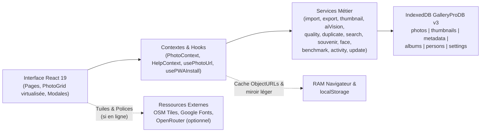

<p align="center">
  
</p>

<h1 align="center">Gallery Pro — Your Visual Legacy</h1>

<p align="center">
  <strong>Votre photothèque personnelle. Intelligente, privée et indépendante du cloud.</strong>
</p>

<p align="center">
  
  
  
  
  
</p>

<p align="center">
  <a href="https://github.com/nouhailler/photorapp">Dépôt GitHub</a> ·
  <a href="#présentation-du-produit">Découvrir le produit</a> ·
  <a href="#fonctionnalités-détaillées">Fonctionnalités</a> ·
  <a href="#confidentialité-et-architecture-local-first">Confidentialité</a> ·
  <a href="#installation-et-prise-en-main">Installation</a> ·
  <a href="CONTEXT.md">Documentation technique</a> ·
  <a href="CHANGELOG.md">Changelog</a>
</p>

---

## Sommaire

- [Présentation du produit](#présentation-du-produit)
- [Présentation visuelle](#présentation-visuelle)
- [Fonctionnalités détaillées](#fonctionnalités-détaillées)
- [Confidentialité et architecture Local-First](#confidentialité-et-architecture-local-first)
- [Tableau comparatif des caractéristiques](#tableau-comparatif-des-caractéristiques)
- [Installation et prise en main](#installation-et-prise-en-main)
- [Architecture technique](#architecture-technique)
- [Organisation du code](#organisation-du-code)
- [Compatibilité et limites](#compatibilité-et-limites)
- [FAQ](#faq)
- [Roadmap](#roadmap)
- [Conclusion et liens utiles](#conclusion-et-liens-utiles)

---

## Présentation du produit

**Gallery Pro** (dépôt `photorapp`) est une application web progressive (**PWA**) de gestion de photothèque personnelle conçue selon une approche **Local-First**. Vos photographies importées, leurs métadonnées EXIF, vos albums et vos retouches restent stockés localement dans votre navigateur via **IndexedDB**, sans création de compte obligatoire ni hébergement cloud imposé.

### À qui s'adresse Gallery Pro ?

- **Photographes amateurs et exigeants** souhaitant inspecter leurs données EXIF, trier les clichés flous ou surexposés, éliminer les doublons exacts ou similaires et conserver des archives portables.
- **Particuliers soucieux de leur vie privée** qui refusent de confier leurs archives familiales à des serveurs tiers ou de dépendre d'un abonnement cloud.
- **Utilisateurs novices** guidés dès l'ouverture par un parcours d'accueil, un menu structuré par catégories et des infobulles contextuelles activables sur chaque contrôle.

### Quel problème résout l'application ?

La plupart des photothèques modernes imposent un compromis difficile : soit de simples visionneuses locales dépourvues de recherche multicritère, de détection de doublons et de sauvegarde structurée ; soit des plateformes cloud propriétaires qui centralisent vos clichés sur des serveurs distants, limitent l'exportation et conditionnent l'accès à un compte.

**Gallery Pro** réunit dans un environnement unique exécuté dans le navigateur :

- **Organisation durable** : galerie chronologique, albums manuels et albums intelligents dynamiques.
- **Exploration rapide** : recherche multicritère, filtres EXIF, interprétation de requêtes en langage naturel et carte GPS.
- **Retouche non destructive** : réglages visuels, recadrage, filtres et exportation sans altérer le fichier maître original.
- **Préservation active** : sauvegardes intégrales en archive `.gpro.zip` vérifiées par empreinte **SHA-256**, simulation de restauration avant écriture et outils de diagnostic du stockage.

---

## Présentation visuelle


> *Illustration vectorielle de l'interface Gallery Pro (`public/app_preview.svg`). Le logo officiel du projet est disponible dans `public/logo.svg`, accompagné des icônes PWA `public/icon.svg`, `public/icons.svg` et `public/favicon.svg`.*

### Parcours visuels de l'application (emplacements prévus pour captures réelles)

Le dépôt contient actuellement des visuels vectoriels (`public/logo.svg`, `public/app_preview.svg`) ainsi que des maquettes de conception initiales dans `stitch_photorapp/`. Pour documenter l'interface exécutée en production, les captures suivantes sont prévues dans l'arborescence éditoriale :

| Écran | Route | Rôle dans le parcours utilisateur | Statut visuel actuel |
| :--- | :--- | :--- | :--- |
| **Galerie principale** | `/` | Mur chronologique, carrousel Souvenirs, sélection par lot | À capturer depuis l'app en exécution |
| **Albums et sélections** | `/albums` | Albums manuels, albums intelligents, couverture et partage local | À capturer depuis l'app en exécution |
| **Recherche avancée** | `/search` | Barre sémantique, badges d'interprétation, filtres date/lieu/appareil | À capturer depuis l'app en exécution |
| **Éditeur non destructif** | Modale depuis `/` | Curseurs lumière/couleur, filtres, comparaison avant/après, recadrage | À capturer depuis l'app en exécution |
| **Module Intelligence & Qualité** | `/ia` | Analyse locale des pixels, doublons SHA-256/dHash, carte GPS, personnes | À capturer depuis l'app en exécution |
| **Sauvegardes & Paramètres** | `/sharing`, `/settings` | Import, export `.gpro.zip`, diagnostic IndexedDB, benchmark, mises à jour | À capturer depuis l'app en exécution |

---

## Fonctionnalités détaillées

### A. Photothèque personnelle

- **Galerie chronologique** (`/`) : regroupement automatique des clichés par date de prise de vue avec en-têtes temporels et indicateurs de favoris ou d'alerte de flou.
- **Importation par lot** (`src/services/importService.ts`) : prise en charge des formats image navigateur (`JPEG`, `PNG`, `WebP`, `GIF`, `AVIF`, `HEIC`/`HEIF`, `TIFF`, `BMP` selon décodage du navigateur), calcul d'empreinte **SHA-256** pour ignorer les doublons exacts, lecture des dimensions et extraction EXIF via `exifreader`.
- **Gestion des métadonnées** : stockage de l'appareil photo, de la résolution en mégapixels, de la date de prise de vue, des coordonnées GPS, de la vitesse d'obturation, de l'ouverture, de l'ISO et de la focale.
- **Consultation et diaporama** (`DetailView.tsx`, `SlideshowModal.tsx`) : vue plein écran avec fiche EXIF détaillée, mise en favori, partage natif (`navigator.share` si disponible) ou téléchargement, et diaporama temporisé (`2s`, `3.5s`, `5s`, lecture aléatoire, raccourcis clavier).
- **Sélection multiple** : suppression atomique de lots et ajout groupé à un album.

### B. Albums et organisation intelligente

- **Albums manuels** (`/albums`, `/albums/:id`) : création, renommage, définition manuelle de la photo de couverture, ajout/retrait de photos et suppression sans détruire les clichés originaux.
- **Albums intelligents dynamiques** (`src/services/smartAlbumService.ts`) : collections calculées à la volée selon des critères combinables :
  - Photos favorites (`isFavorite`),
  - Année (`year`), mois (`month`) ou plage de dates (`dateRange`),
  - Tag précis (`tag`), lieu (`location`), présence de coordonnées GPS (`hasGps`),
  - État de netteté (`isBlurry`) et modèle d'appareil (`cameraModel`).
- **Cohérence des suppressions** : lorsqu'une photo est supprimée, ses références dans les albums et les couvertures d'albums concernés sont automatiquement mises à jour dans IndexedDB.

### C. Recherche avancée et intelligente

Le moteur de recherche (`/search`, `searchEngine.ts` et `naturalSearchService.ts`) combine filtrage multicritère structuré et analyse lexicale locale en français et en anglais :

- **Recherche textuelle multi-mots** : croise description (`alt`), tags manuels, tags de scène, mots-clés automatiques, lieu, appareil photo, marque/modèle EXIF, nom d'album et date.
- **Filtres combinables** : année, mois, album, favoris uniquement, photos géolocalisées (`hasGps`), lieu exact, modèle d'appareil, détection de flou et score de qualité minimum (`minQuality`).
- **Interprétation de requêtes naturelles** : détection d'intentions (`favoris`, `coups de cœur`, `flou`, `gps`, `carte`), détection d'années (`1990`–`2040`), détection de saisons (`hiver`, `printemps`, `été`, `automne`) et expansion via un dictionnaire de synonymes de concepts (`montagne`, `plage`, `mer`, `forêt`, `ville`, `bâtiment`, `coucher`, `nuit`, `portrait`, `chien`, `chat`, `animal`, `voiture`, `fleur`, `jardin`).

**Exemples de requêtes effectivement interprétées :**

- `Montagnes en hiver` → filtre sur le mois de janvier et les tags `montagne`, `sommet`, `neige`, `alpes`, `nature`.
- `Photos de plage avec GPS` → active le filtre `hasGps = true` et recherche les tags `plage`, `mer`, `océan`, `sable`, `côte`, `eau`.
- `Coups de cœur 2024 à Paris` → filtre `isFavorite = true`, `year = 2024` et recherche textuelle `paris`.
- `Photos floues` → filtre `isBlurry = true`.

**Limites connues du moteur de recherche :**

- **Aucune compréhension vectorielle ou LLM** : l'interprétation repose sur des règles lexicales et un dictionnaire statique de 17 concepts.
- **Saisons mappées sur un seul mois** : une recherche contenant `hiver`, `printemps`, `été` ou `automne` filtre sur le mois central de la saison (respectivement janvier, avril, juillet ou octobre) et non sur les trois mois complets.
- **Attributs visuels libres** : une requête comme `Voitures rouges` reconnaît le concept `voiture`, mais traite `rouges` comme un simple mot-clé textuel (il n'existe pas encore d'index de recherche par nom de couleur).

### D. Intelligence photographique

Accessible via l'onglet `/ia` (`IntelligenceIA.tsx`), l'analyse fonctionne **localement dans le navigateur** sans envoi de photographies vers un serveur :

- **Analyse de scène par heuristiques de traitement d'image** (`src/services/aiVisionService.ts`) :
  - Rééchantillonnage de l'image sur Canvas (`180px` de large).
  - Extraction des 5 couleurs hexadécimales dominantes par quantification RGB.
  - Calcul d'histogrammes HSV (teintes chaudes, vertes, bleues, saturation et luminance moyennes).
  - Segmentation spatiale simple (tiers supérieur pour la détection de ciel bleu, tiers inférieur pour verdure ou sable).
  - Estimation de densité et d'orientation des contours de type Sobel (distinction approximative entre lignes horizontales/verticales pour `Architecture & Ville` et textures obliques pour `Animaux & Faune`).
  - Règles de classification générant des étiquettes (`Nature & Paysage`, `Plage & Mer`, `Coucher de soleil`, `Architecture & Ville`, `Nuit & Basse lumière`, `Portrait & Personnes`, `Animaux & Faune`) et des `autoKeywords` ajoutés aux tags.
- **Regroupement de personnes (opt-in, expérimental)** (`src/services/faceService.ts`) :
  - Désactivé par défaut (`gallery_pro_faces_enabled`), activable explicitement par l'utilisateur.
  - Filtre les photos déjà classées comme portraits ou présentant un ratio de tons chair central supérieur au seuil heuristique, puis crée des groupes anonymes (`Personne 1`, `Personne 2`...) renommables ou supprimables manuellement.
  - **Effacement complet** : le bouton de réinitialisation exécute `clearAllFaceData()`, purgeant l'intégralité du store IndexedDB `persons` et désactivant le module sans toucher aux photos originales.

> **Transparence technique :** `aiVisionService.ts` et `faceService.ts` n'utilisent **aucun modèle d'apprentissage profond (CNN/ViT), aucun moteur ONNX/TensorFlow.js, ni aucune reconnaissance biométrique faciale**. Le regroupement de personnes procède par lots séquentiels (`CHUNK_SIZE = 4`) sur des clichés tagués portrait, et non par calcul d'empreintes faciales vectorielles (embeddings). Par ailleurs, une section optionnelle dans `/ia` permet d'interroger le catalogue des modèles `:free` d'**OpenRouter** (`https://openrouter.ai/api/v1/models`) et de mémoriser une clé API en `localStorage`, sans qu'aucune analyse d'image distante ne soit actuellement déclenchée depuis ce module.

### E. Souvenirs photographiques

Le générateur de souvenirs (`src/services/souvenirService.ts` et `SouvenirsCarousel.tsx`) affiche automatiquement des cartes rétrospectives en haut de la galerie à partir **exclusivement** des dates et lieux réels présents dans votre photothèque :

- **Ce jour-là, il y a 1 an** et **Ce jour-là, il y a plusieurs années** (`2`, `3`, `5`, `7`, `10` ans).
- **À cette période de l'année** : clichés capturés les années précédentes dans une fenêtre de `±6 jours` autour de la date courante (à partir de 3 photos).
- **Escapades & Voyages** : regroupement par lieu renseigné (au moins 4 photos, hors `Lieu inconnu`, limité à 3 escapades).
- **Vos coups de cœur de toujours** : sélection de favoris datant de plus de 6 mois (à partir de 3 photos).

### F. Retouche photographique

L'éditeur intégré (`src/components/Editor.tsx`) enregistre toutes les modifications dans `photo.adjustments` sous forme de paramètres JSON, **sans jamais écraser le fichier original** conservé dans le store `photos` d'IndexedDB :

- **Réglages disponibles** : luminosité (`brightness`), contraste (`contrast`), saturation (`saturation`), exposition (`exposure`), température (`temperature`), teinte (`tint`), hautes lumières (`highlights`), ombres (`shadows`), vignettage (`vignette`).
- **Réglage automatique (« Auto »)** : applique un préréglage équilibré non destructif et réinitialisable en un clic.
- **Filtres créatifs** : `Original`, `Vivid`, `Noir & Blanc`, `Cinéma`, `Sépia`, `Rétro`, `Froid`.
- **Géométrie** : rotation par paliers de `90°`, ratios `Original`, `1:1`, `4:3`, `16:9` et recadrage personnalisé par marges (`cropRect`).
- **Comparaison & Export** : bouton de comparaison maintenu (`Original` / `Retouché`) et rendu sur Canvas JPEG (`qualité 0.92`) à l'export.

**Limites actuelles de l'éditeur :**

- Les curseurs `Hautes lumières` (`highlights`) et `Ombres` (`shadows`) sont enregistrés dans l'objet `adjustments`, mais ne disposent pas encore de transformation de pixels dédiée dans l'aperçu CSS ni lors de l'export Canvas.
- Le curseur `Teinte` (`tint`) est prévisualisé dans l'éditeur via rotation de teinte CSS, mais n'est pas encore reporté dans le rendu d'export Canvas (`exportService.ts`).
- Les vues `DetailView.tsx` et `SlideshowModal.tsx` appliquent principalement luminosité, contraste, saturation, filtre prédéfini et rotation (sans prévisualiser vignettage, température ou recadrage libre).

### G. Qualité et détection des doublons

- **Analyse de netteté et d'exposition** (`src/services/qualityService.ts`) : calcule la variance du Laplacien sur un échantillon redimensionné (seuil `isBlurry` si variance `< 120`) et la luminance moyenne (`< 35` sous-exposé, `> 225` surexposé), produisant un score indicatif de `5` à `100`.
- **Détection des doublons exacts** (`findExactDuplicates`) : regroupe uniquement les fichiers partageant un hash cryptographique **SHA-256** identique afin d'éviter toute suppression erronée.
- **Détection de quasi-doublons / rafales** (`findSimilarPhotos`) : compare l'empreinte perceptuelle `dHash` (64 bits calculés sur une grille 9×8) avec une distance de Hamming `<= 6`.
- **Aide à la décision** : ces scores constituent des **indicateurs techniques** (un portrait à faible profondeur de champ avec arrière-plan flou peut obtenir une variance faible). La suppression reste toujours une action manuelle confirmée par l'utilisateur.

### H. Géolocalisation

- **Extraction GPS EXIF** : lors de l'importation, `exifreader` extrait la latitude et la longitude lorsqu'elles sont présentes dans le fichier.
- **Carte interactive** (`src/components/MapComponent.tsx`) : affiche les clichés géolocalisés via **Leaflet** et **React-Leaflet**, avec infobulle et accès direct à la photo.
- **Limites et dépendance réseau** :
  - Les fonds de carte utilisent les tuiles **OpenStreetMap** (`https://{s}.tile.openstreetmap.org/{z}/{x}/{y}.png`), qui nécessitent une connexion Internet. En mode hors ligne, une bannière d'avertissement s'affiche sans bloquer le reste de l'application.
  - Les photos dépourvues de métadonnées GPS (ex. images issues de messageries ou captures d'écran) ne sont pas placées sur la carte.

### I. Sauvegarde et préservation

La pérennité de votre photothèque repose sur des outils dédiés accessibles dans `/sharing` et `/settings` :

- **Stockage structuré dans IndexedDB v3** : séparation entre les blobs originaux (`photos`), les miniatures d'affichage (`thumbnails`), les fiches métadonnées (`metadata`), les albums (`albums`), les groupes de personnes (`persons`) et les réglages (`settings`).
- **Sauvegarde intégrale `.gpro.zip`** (`createFullLibraryBackup`) : génère une archive ZIP portable contenant `backup_manifest.json` (`manifest_version: 2`), `metadata.json` (photos et albums), l'ensemble des fichiers originaux locaux dans `photos/` et les empreintes **SHA-256** de chaque blob pour contrôler l'intégrité à la restauration.
- **Simulation de restauration sans écriture** (`simulateRestoreBackup` & `RestoreSimulationModal`) : avant de modifier IndexedDB, inspecte le manifeste et le ZIP pour afficher le nombre de nouvelles photos, les doublons déjà présents, les blobs manquants et les éventuelles erreurs SHA-256.
- **Restauration vérifiée** (`restoreFullLibraryBackup`) : contrôle chaque empreinte SHA-256 déclarée avant d'écrire les blobs, met à jour les métadonnées/albums et régénère les miniatures manquantes. *(Note technique : les écritures sont séquentielles et mettent à jour les identifiants existants sans rollback global automatique en cas d'interruption en milieu de processus).*
- **Maintenance et réparation** :
  - `diagnoseStorage()` : vérifie le support d'IndexedDB, le quota estimé (`navigator.storage.estimate`), le nombre de blobs/miniatures manquants ou orphelins.
  - `regenerateAllMissingThumbnails()` : reconstruit en lot les miniatures absentes à partir des originaux.
  - `cleanupOrphanedBlobs()` et `cleanupOrphanedThumbnails()` : suppriment les données binaires résiduelles sans fiche associée.
- **Export utilisateur** : exportation du catalogue en `JSON`, téléchargement d'une photo isolée (originale ou retouchée) ou d'une sélection en archive ZIP.

> **Rappel critique de sauvegarde :** Le stockage dans **IndexedDB** dépend du profil de votre navigateur sur un appareil donné. Une purge des données du site, une désinstallation du navigateur, un changement de poste ou une panne matérielle entraîne la perte des données locales. **L'utilisation régulière de la sauvegarde externe `.gpro.zip` (sur disque externe, NAS ou support tiers chiffré) reste indispensable.**

### J. Performance

L'architecture vise à garder l'interface réactive à mesure que le catalogue grandit :

- **Miniatures dédiées** (`src/services/thumbnailService.ts`) : chaque photo importée génère une miniature redimensionnée à `360px` max en `WebP` (`qualité 0.8`, repli `JPEG`), évitant de décoder les originaux de plusieurs mégaoctets dans la grille.
- **Virtualisation de la grille** (`src/components/PhotoGrid.tsx`) : au-delà de `48` photos (hors mode vitrine `featured`), un fenêtrage par lignes avec marge (`OVERSCAN = 3`) ne rend dans le DOM que les lignes visibles autour du défilement (`requestAnimationFrame` passif).
- **Mise en cache contrôlée des URLs** (`PhotoContext.tsx`) : les `ObjectURL` générées depuis IndexedDB sont mises en cache par identifiant (`id` et `${id}_thumb`) et révoquées lors du démontage du contexte.
- **Exécution asynchrone sur le thread principal** : les opérations longues cèdent la main à la boucle d'événements par lots ; **l'application n'utilise pas encore de Web Workers** (bien que `createImageBitmap` et `OffscreenCanvas` soient exploités lorsque le navigateur les supporte).
- **Suite de benchmark intégrée** (`src/services/benchmarkService.ts`, page `/settings`) : génère en mémoire des jeux de données synthétiques (`1 000`, `5 000`, `10 000` et `20 000` métadonnées de photos marquées `remote`) et chronomètre via `performance.now()` la génération, l'indexation en `Map`, la recherche plein texte, le filtrage multicritère, le groupement par date, le tri et l'estimation mémoire JS.

> **Distinction importante sur la capacité :** L'application intègre une virtualisation et un benchmark synthétique pensés pour monter jusqu'à **20 000 fiches en mémoire**, mais **aucune mesure automatisée en conditions réelles navigateur à 20 000 blobs IndexedDB (décodage disque, quota et FPS réels de défilement) n'est actuellement attestée par des tests E2E dans le dépôt**. Les résultats du benchmark `/settings` reflètent uniquement les performances CPU/RAM sur votre machine pour les opérations sur métadonnées.

### K. PWA et expérience utilisateur

- **PWA installable** (`vite-plugin-pwa`, `usePWAInstall`, `PWAInstallButton`) : détection de l'événement `beforeinstallprompt` sur navigateurs Chromium (desktop/Android) et guide visuel dédié pour l'ajout à l'écran d'accueil sur **iOS Safari**.
- **Menu Hamburger catégorisé** (`HamburgerMenu.tsx`) : regroupe l'accès par 4 familles (*Photothèque & Souvenirs*, *Outils Intelligents & Qualité*, *Gestion des Données*, *Système & Préférences*).
- **Onboarding et mentions légales** (`OnboardingModal.tsx`) : présentation initiale et acceptation explicite d'une clause de non-responsabilité rappelant que l'utilisateur conserve la responsabilité exclusive de ses fichiers et sauvegardes.
- **Mode accompagnement novice** (`HelpContext.tsx`, `HelpTooltip.tsx`) : bulles d'aide `?` contextuelles sur l'ensemble des formulaires et curseurs, activables ou désactivables à tout moment.
- **Centre d'activité** (`ActivityCenterModal.tsx`, `activityService.ts`) : suivi des tâches longues avec barre de progression et bouton d'interruption (`AbortController`). *(Actuellement relié au traitement par lot d'analyse locale `analyzeAllPhotos` ; l'importation, la sauvegarde et le nettoyage utilisent leurs indicateurs propres).*
- **Paramètres système et mises à jour** (`/settings`, `updateService.ts`) : affichage de la version (`2.5.0`) et de la date de sortie (`13 Novembre 2026`), date de dernière vérification, bouton *« Vérifier les mises à jour »* (Service Worker + en-tête `ETag`), bouton *« Forcer la mise à jour »* (purge du CacheStorage sans toucher à IndexedDB) et vérification automatique périodique en arrière-plan (activée par défaut).

---

## Confidentialité et architecture Local-First

**Gallery Pro** sépare strictement le stockage de vos photographies personnelles du fonctionnement des ressources web de l'interface :

1. **Où vivent vos photos et métadonnées ?**
   Toutes les photographies importées, leurs miniatures et leurs fiches EXIF/albums résident exclusivement dans la base **IndexedDB** (`GalleryProDB` v3) de votre navigateur (avec un miroir JSON léger des métadonnées en `localStorage` tant que le quota le permet).
2. **Traitements locaux**
   Le hachage SHA-256, l'extraction EXIF, la génération de miniatures, le scoring de netteté/exposition, les empreintes `dHash`, l'analyse heuristique de scènes, le moteur de recherche et la création d'archives `.gpro.zip` s'exécutent dans votre navigateur.
3. **Accès réseau effectivement présents dans le code**
   Pour éviter toute ambiguïté, voici les requêtes réseau externes susceptibles d'être émises par l'application :
   - **Polices et icônes** (`index.html`) : chargement de *Inter* et *Material Symbols Outlined* depuis `fonts.googleapis.com`.
   - **Fonds de carte géographiques** (`MapComponent.tsx`) : chargement des tuiles OpenStreetMap depuis `tile.openstreetmap.org` lors de l'affichage de la carte.
   - **Clichés de démonstration initiaux** (`mockData.ts` & `Albums.tsx`) : au tout premier démarrage à vide, 3 photos d'exemple et une couverture de secours pointent vers des URLs distantes (`lh3.googleusercontent.com` / `images.unsplash.com`). Dès que vous importez vos propres photos (`storage: 'local'`), elles sont lues depuis IndexedDB.
   - **Catalogue optionnel OpenRouter** (`openrouter.ts` sur `/ia`) : appel à `https://openrouter.ai/api/v1/models` uniquement si vous ouvrez la configuration et cliquez sur charger la liste des modèles gratuits.
   - **Vérification de mise à jour** (`updateService.ts`) : requête `HEAD /?t=...` vers le domaine d'hébergement de l'application pour comparer l'en-tête `ETag`.
4. **Fonctionnement hors ligne et limite navigateur**
   Une fois le Service Worker mis en cache après une première visite, l'interface, la photothèque locale, la recherche, l'éditeur, l'analyse locale et les sauvegardes restent utilisables hors connexion (hors tuiles de carte et polices non déjà en cache). En revanche, **IndexedDB reste lié au profil de votre navigateur** : en cas d'effacement des données de navigation ou de perte de l'appareil, seules vos sauvegardes `.gpro.zip` exportées permettent de restaurer vos souvenirs.

---

## Tableau comparatif des caractéristiques

| Caractéristique | État vérifié dans Gallery Pro (v2.5.0) | Précisions issues du code |
| :--- | :--- | :--- |
| **Stockage photographique local** | **Opérationnelle** | Originaux et miniatures dans IndexedDB (`GalleryProDB` v3) |
| **Compte obligatoire** | **Aucun** | Utilisation immédiate sans inscription ni authentification |
| **Fonctionnement hors ligne** | **Opérationnelle (avec nuances)** | App et données locales hors ligne via PWA/SW ; carte OSM et polices Google nécessitent un premier chargement en ligne |
| **Recherche avancée** | **Opérationnelle** | Texte multi-mots, année, mois, lieu, appareil, favoris, GPS, flou, score qualité |
| **Recherche en langage naturel** | **Opérationnelle (par règles)** | Analyseur lexical FR/EN (17 concepts, saisons sur mois central, intentions, années) ; sans modèle LLM |
| **Analyse photographique locale** | **Expérimentale (heuristiques)** | Couleurs HSV, segmentation spatiale, contours type Sobel, netteté Laplacien, `dHash` ; sans modèle IA neuronal |
| **Regroupement des visages** | **Expérimentale (opt-in)** | Groupement séquentiel par lots de photos portrait + renommage + purge ; sans biométrie faciale |
| **Albums intelligents** | **Opérationnelle** | Évaluation dynamique multicritère en temps réel |
| **Éditeur non destructif** | **Partielle / Opérationnelle** | Luminosité, contraste, saturation, expo, température, vignettage, filtres, rotation, recadrage ; `highlights`/`shadows` sans rendu actif et `tint` absent de l'export Canvas |
| **Sauvegarde exportable** | **Opérationnelle** | Archive `.gpro.zip` complète avec manifeste v2, SHA-256 et simulation de restauration préalable |
| **Centre d'activité** | **Partielle** | Suivi et annulation opérationnels pour l'analyse par lot ; autres opérations non encore raccordées |
| **PWA installable** | **Opérationnelle** | `vite-plugin-pwa`, invite native desktop/Android + guide iOS Safari |

---

## Installation et prise en main

### Prérequis

- **Node.js** (version LTS recommandée, compatible Vite 8 et TypeScript ~6.0)
- **npm** (inclus avec Node.js)

### Commandes disponibles (`package.json`)

```bash
# 1. Cloner le dépôt
git clone https://github.com/nouhailler/photorapp.git
cd photorapp

# 2. Installer les dépendances
npm install

# 3. Lancer le serveur de développement (port 3000)
npm run dev

# 4. Vérifier la qualité du code (ESLint)
npm run lint

# 5. Exécuter les tests unitaires et d'intégration (Vitest)
npm run test -- --run

# 6. Compiler le bundle de production (TypeScript + Vite)
npm run build

# 7. Prévisualiser le build de production localement
npm run preview
```

### Première utilisation (pas à pas)

1. **Ouvrir l'application** : lancez `npm run dev` puis ouvrez `http://localhost:3000` dans votre navigateur.
2. **Valider l'accueil et les mentions légales** : parcourez l'onboarding en 3 étapes et cochez la confirmation de responsabilité locale.
3. **Importer des photographies** : cliquez sur le bouton d'importation dans la barre supérieure (ou allez dans `/sharing`) et sélectionnez un lot d'images. L'extraction EXIF, le hash SHA-256 et la génération des miniatures démarrent immédiatement.
4. **Créer un album** : ouvrez **Albums** (`/albums`), créez un album manuel ou définissez un **Album Intelligent** (par exemple : *Favoris avec GPS*).
5. **Explorer la recherche et l'analyse** : lancez l'analyse locale depuis `/ia` pour enrichir les tags et la détection de netteté, puis testez une requête sur `/search`.
6. **Effectuer une première sauvegarde** : rendez-vous dans **Sauvegardes & Données** (`/sharing`) pour générer votre première archive `.gpro.zip` et la stocker en lieu sûr.

---

## Architecture technique

### Stack vérifiée (`package.json`)

- **Interface & Rendu** : React `19.2.6`, React DOM `19.2.6`, Tailwind CSS `3.4.1`
- **Langage & Bundler** : TypeScript `~6.0.2`, Vite `8.0.12`, `vite-plugin-pwa` `1.3.0`
- **Navigation** : React Router DOM `7.17.0`
- **Persistance & Fichiers** : IndexedDB natif (`GalleryProDB` v3), `jszip` `3.10.2`, `exifreader` `4.54.0`
- **Cartographie** : `leaflet` `1.9.4`, `react-leaflet` `5.0.0`
- **Icônes & UI** : `lucide-react` `1.17.0`, Google Material Symbols Outlined
- **Tests & Qualité** : Vitest `4.1.8`, Testing Library React `16.3.2`, jsdom `29.1.1`, ESLint `10.3.0`

### Schéma d'architecture générale



---

## Organisation du code

Arborescence principale réellement présente dans le dépôt :

```text
photorapp/
├── index.html                  # Point d'entrée HTML, métadonnées SEO et polices Google
├── metadata.json               # Nom et description de l'application
├── netlify.toml                # Configuration de build et redirection SPA (/* -> /index.html)
├── package.json                # Dépendances et scripts (dev, build, lint, preview, test)
├── vite.config.ts              # Configuration Vite (port 3000), PWA et Vitest
├── public/                     # Assets statiques : logo.svg, app_preview.svg, icon.svg, icons.svg, favicon.svg
├── stitch_photorapp/           # Maquettes visuelles historiques (Stitch)
└── src/
    ├── App.tsx                 # Définition des 7 routes principales
    ├── main.tsx                # Montage React
    ├── assets/data/mockData.ts # Jeu de 3 photos et 2 albums d'exemple initiaux
    ├── components/             # Composants UI : PhotoGrid, Editor, DetailView, SlideshowModal,
    │                           # MapComponent, HamburgerMenu, OnboardingModal, HelpTooltip,
    │                           # PWAInstallButton, ActivityCenterModal, RestoreSimulationModal, etc.
    ├── context/                # PhotoContext, HelpContext et hooks associés (usePhotos, useHelp)
    ├── hooks/                  # usePhotoUrl (résolution blob/miniature), usePWAInstall
    ├── pages/                  # Gallery, Albums, AlbumDetail, Search, IntelligenceIA, Sharing, SystemSettings
    ├── services/               # 14 services métier (+ tests unitaires associés)
    ├── types/types.ts          # Interfaces TypeScript (Photo, Album, PhotoAnalysis, PersonGroup...)
    └── utils/                  # db.ts (IndexedDB v3, migration, diagnostic), openrouter.ts
```

---

## Compatibilité et limites

- **Navigateurs compatibles** : navigateurs web modernes supportant IndexedDB, Web Crypto (`crypto.subtle` pour SHA-256), Canvas 2D et ES Modules (Chromium/Chrome/Edge, Firefox, Safari modernes). *Aucune matrice de tests automatisés multi-navigateurs ou E2E Playwright/Cypress n'est actuellement présente dans le dépôt ; seuls les tests Vitest sous `jsdom` sont exécutés.*
- **Compatibilité mobile** : interface responsive avec barre de navigation inférieure sur mobile (`< 768px`), menu Hamburger latéral et installation PWA (invite native sur Android/Chrome, guide manuel sur iOS Safari).
- **Dépendance à IndexedDB et quotas** : la capacité réelle de stockage dépend de l'espace disque disponible et du quota accordé par le navigateur au domaine. Sur iOS/Safari, certaines règles d'éviction de stockage peuvent s'appliquer si le site reste inutilisé longtemps sans installation sur l'écran d'accueil.
- **Absence de WebGPU / WebGL pour l'IA** : aucune dépendance à WebGPU ; tous les calculs d'image s'exécutent via Canvas 2D sur CPU.
- **Limites des analyses automatiques** : les étiquettes de scène, le score de netteté et le regroupement des visages sont des estimations heuristiques et peuvent produire des faux positifs.
- **Dépendances réseau** : la carte géographique (OpenStreetMap), les polices/icônes (Google Fonts) et les images d'exemple initiales requièrent une connexion Internet lors du premier chargement.

---

## FAQ

**Mes photos sont-elles envoyées sur un serveur ?**
Non. Les photos importées sont lues localement par votre navigateur et enregistrées dans sa base IndexedDB locale. Le seul connecteur externe optionnel (`/ia`, OpenRouter) se limite actuellement à récupérer la liste publique des modèles gratuits si vous le demandez.

**Ai-je besoin d'un compte pour utiliser l'application ?**
Non. Aucun compte, e-mail ni authentification n'est requis.

**Puis-je utiliser Gallery Pro hors ligne ?**
Oui pour la gestion de votre photothèque locale : l'application est configurée en PWA avec Service Worker (`vite-plugin-pwa`), ce qui permet la consultation, la recherche, la retouche et l'exportation sans connexion une fois l'application chargée au moins une fois. En revanche, les tuiles de la carte OpenStreetMap et le chargement initial des polices Google Fonts requièrent un accès réseau.

**Où sont stockées mes photos ?**
Dans la base **IndexedDB** nommée `GalleryProDB` (version 3), propre au profil de votre navigateur et au domaine utilisé. Les originaux sont dans le store `photos` et les aperçus compressés dans `thumbnails`.

**Que se passe-t-il si je change de navigateur ou efface mes données de navigation ?**
Un autre navigateur ou un autre profil ne partage pas la base IndexedDB : votre photothèque y apparaîtra vide. De même, effacer les données du site supprime la photothèque locale. Exportez toujours une archive `.gpro.zip` avant de changer d'appareil ou de réinitialiser votre navigateur.

**Comment sauvegarder ma photothèque ?**
Rendez-vous dans la page **Import & Sauvegardes** (`/sharing`) et cliquez sur la sauvegarde intégrale pour télécharger un fichier `.gpro.zip` contenant vos fichiers originaux, vos métadonnées, vos albums et le manifeste SHA-256.

**Puis-je restaurer mes photos sur un autre ordinateur ?**
Oui. Ouvrez Gallery Pro sur le second ordinateur, accédez à `/sharing`, sélectionnez votre fichier `.gpro.zip` pour lancer la simulation de vérification, puis confirmez la restauration.

**Les modifications dans l'éditeur détruisent-elles les originaux ?**
Non. Les réglages (luminosité, contraste, rotation, filtres, recadrage) sont stockés en JSON dans `photo.adjustments`. L'image maître d'origine reste intacte dans IndexedDB et peut être restaurée à tout moment via « Réinitialiser ».

**La recherche intelligente nécessite-t-elle une clé API ?**
Non. La recherche avancée et l'analyseur de requêtes naturelles fonctionnent entièrement en local par règles et synonymes.

**L'application fonctionne-t-elle sur smartphone ?**
Oui. L'interface s'adapte aux écrans mobiles, propose un menu Hamburger catégorisé et peut être installée sur l'écran d'accueil sur Android (via Chrome/Edge) comme sur iOS (via Safari, *Partager → Sur l'écran d'accueil*).

**Que se passe-t-il si je désinstalle la PWA ?**
Selon le système d'exploitation et le navigateur, la désinstallation de la PWA peut ou non conserver les données de site (IndexedDB). Par prudence, réalisez systématiquement une sauvegarde `.gpro.zip` avant de désinstaller l'application.

---

## Roadmap

### Déjà disponible (v2.5.0)

- Importation par lot avec EXIF/GPS, SHA-256 et génération de miniatures WebP/JPEG.
- Galerie chronologique avec virtualisation de grille (`> 48` photos) et carrousel Souvenirs.
- Albums manuels et albums intelligents dynamiques.
- Recherche multicritère et analyseur lexical en langage naturel FR/EN.
- Éditeur non destructif, diagnostic qualité/doublons, carte Leaflet GPS.
- Sauvegarde `.gpro.zip` avec manifeste v2, simulation de restauration, réparation de stockage et PWA.

### Améliorations envisagées (dette technique identifiée dans le code)

- Harmoniser `highlights`, `shadows` et `tint` entre l'aperçu de l'éditeur, l'export Canvas (`exportService.ts`) et l'affichage dans `DetailView.tsx`.
- Raccorder les opérations d'importation, de sauvegarde ZIP, de restauration et de régénération de miniatures au `activityService` (actuellement limité à l'analyse par lot).
- Embarquer localement les polices/icônes pour supprimer la dépendance réseau Google Fonts en environnement strictement hors ligne.
- Aligner le numéro de version dans `package.json` (`0.0.0`) sur la version applicative (`2.5.0`).

### Fonctionnalités expérimentales actuelles

- Classification heuristique de scènes (`aiVisionService.ts`).
- Regroupement opt-in de personnes par lots (`faceService.ts`).
- Benchmark synthétique sur métadonnées en mémoire (`benchmarkService.ts`).

### Pistes de développement futures (non implémentées)

- Déport des calculs d'analyse, de hachage et de génération de miniatures dans des **Web Workers**.
- Intégration éventuelle d'un véritable modèle léger d'inférence locale ou d'une recherche vectorielle par couleurs/similarités visuelles.
- Tests automatisés de bout en bout (E2E) en navigateur réel sur de grands volumes IndexedDB.

---

## Conclusion et liens utiles

**Gallery Pro** pose les bases d'une photothèque web indépendante, transparente sur son fonctionnement local et dotée de véritables garde-fous de préservation de données.

- **Dépôt GitHub :** [https://github.com/nouhailler/photorapp](https://github.com/nouhailler/photorapp)
- **Historique des versions :** [CHANGELOG.md](CHANGELOG.md)
- **Architecture et référence développeur :** [CONTEXT.md](CONTEXT.md)
- **Signaler un problème ou proposer une amélioration :** [Issues GitHub](https://github.com/nouhailler/photorapp/issues)
- **Licence :** Aucun fichier `LICENSE` n'est actuellement présent dans le dépôt ; vérifiez le statut de licence auprès du mainteneur avant toute redistribution.
