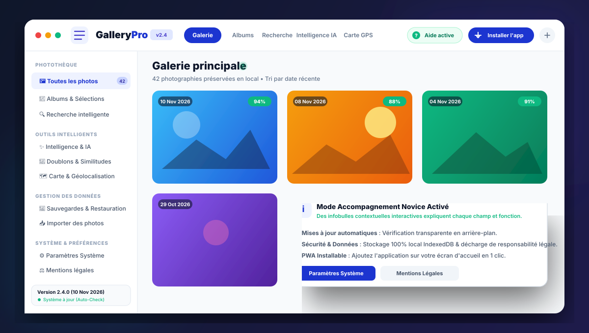

<p align="center">
  
</p>

<p align="center">
  <strong>Photothèque intelligente, privée, haute performance et 100% locale pour photographes et passionnés d'images.</strong>
</p>

<p align="center">
  
  
  
  
  
</p>

---

## 📸 Aperçu de l'application



---

## 🌟 Points Forts & Fonctionnalités Majeures

| Catégorie | Fonctionnalité | Description | Statut |
| :--- | :--- | :--- | :--- |
| **🧠 IA Vision Locale** | **Classification sémantique & Visages** | Reconnaissance locale des scènes (Paysages, Portraits, Plages, Nuit), mots-clés auto et regroupement biométrique opt-in avec effacement irréversible. | ✅ Opérationnel |
| **🔎 Langage Naturel** | **Recherche conversationnelle** | Requêtes naturelles (« Montagnes en hiver », « Chiens dans un jardin », « Coups de cœur GPS ») interprétées localement. | ✅ Opérationnel |
| **✨ Souvenirs** | **Rétrospectives authentiques** | Carrousel automatique « Il y a 1 an », « Même période » et « Escapades » basé uniquement sur vos dates et lieux EXIF réels. | ✅ Opérationnel |
| **⚡ Performances 20k** | **Miniatures WebP & Grille Virtualisée** | Pipeline de miniatures (~20 Ko) dans IndexedDB v3 et fenêtrage virtualisé 60 fps jusqu'à 20 000 photos + suite de benchmark intégrée. | ✅ Opérationnel |
| **🛡️ Préservation** | **Simulation de Restauration & Centre d'Activité** | Prévisualisation avant restauration ZIP, réparation des miniatures manquantes et suivi/annulation des tâches longues. | ✅ Opérationnel |
| **🍔 Menu Hamburger** | **Organisation par catégories** | Accès immédiat regroupé : Photothèque, Outils IA, Gestion Données, Système. | ✅ Opérationnel |
| **📲 PWA & Mobiles** | **Bouton « Installer l'application »** | Installation directe sur l'écran d'accueil (Desktop, Android, iOS Safari) en 1 clic. | ✅ Opérationnel |
| **⚙️ Système** | **Paramètres Système & Mises à jour** | Date de version, vérification manuelle, mise à jour forcée du cache et mises à jour automatiques. | ✅ Opérationnel |
| **💡 Onboarding** | **Aide Novice & Mentions Légales** | Badges `?` interactifs sur tous les champs et clause de non-responsabilité sur les données locales. | ✅ Opérationnel |

---

## 🍔 Menu Hamburger : Organisation par Catégories

Le menu latéral rétractable structure l'ensemble des modules pour une ergonomie optimale sur mobile comme sur grand écran :

1. **Photothèque & Souvenirs**
   - 🖼️ *Toutes les photos* (Galerie chronologique avec grille fluide)
   - 📁 *Albums & Sélections* (Albums manuels et smart albums dynamiques)
   - 🔍 *Recherche Avancée* (Filtres combinés : dates, tags, ville, appareil, score de qualité)

2. **Outils Intelligents & Qualité**
   - ✨ *Intelligence IA & Retouche* (Reconnaissance de scènes, détection de visages, filtres)
   - 👥 *Doublons & Similitudes* (Identification des copies exactes et prises de vue en rafale)
   - 🗺️ *Carte & Géolocalisation* (Visualisation géographique interactive Leaflet via métadonnées EXIF GPS)

3. **Gestion des Données**
   - 💾 *Sauvegardes & Restauration* (Archives complètes ZIP, manifestes v2 et catalogues JSON)
   - 📥 *Importer des photos* (Import par lot, extraction EXIF/GPS, zéro upload cloud)
   - 📊 *Santé du stockage* (Diagnostic IndexedDB et purge des fichiers orphelins)

4. **Système & Préférences**
   - ⚙️ *Paramètres Système* (Gestion des versions et mises à jour)
   - 💡 *Mode Accompagnement Novice* (Activation/désactivation globale des infobulles)
   - ⚖️ *Mentions Légales & Responsabilité* (Conditions d'usage et non-responsabilité)

---

## ⚙️ Paramètres Système & Mises à Jour Automatiques

Accessible directement via la barre de navigation ou l'URL `/settings` :

- **Date de sortie :** `10 Novembre 2026`
- **Version courante :** `v2.4.0`
- **Horodatage de dernière vérification :** Affichage en temps réel de la dernière requête.
- **Bouton « Vérifier les mises à jour » :** Interroge le Service Worker et les en-têtes réseau pour repérer toute nouvelle révision.
- **Bouton « Forcer la mise à jour » :** Purge les caches HTTP/CacheStorage et rafraîchit l'application sans jamais effacer la base de données de photos locale (`GalleryProDB`).
- **Mises à jour automatiques en arrière-plan :** Un service en tâche de fond vérifie périodiquement la disponibilité d'une nouvelle version et l'installe discrètement dès que le réseau le permet.

---

## 💡 Onboarding Novice & Infobulles Contextuelles

Gallery Pro a été spécialement pensé pour être accessible aux utilisateurs novices tout en restant puissant :

- **Onboarding d'accueil en 3 étapes :** Présentation claire des fonctionnalités lors de la première ouverture.
- **Mode Accompagnement Actif :** Des badges `?` apparaissent au niveau de chaque champ de saisie, curseur d'ajustement (exposition, température, contraste...), bouton d'action et filtre de recherche.
- **Activation / Désactivation instantanée :** Un interrupteur présent dans le menu Hamburger et dans l'en-tête permet d'activer ou masquer toutes les infobulles d'un simple geste.

---

## ⚖️ Mentions Légales & Clause de Non-Responsabilité

> ### ⚠️ Avertissement Important sur la Responsabilité des Données
>
> 1. **Stockage Local Exclusif :** L'application **Gallery Pro** fonctionne en architecture *Local-First*. Toutes les photos, métadonnées, albums et ajustements sont stockés exclusivement dans la base de données **IndexedDB** du navigateur web de l'utilisateur.
> 2. **Absence de Responsabilité :** **L'auteur et les développeurs de l'application déclinent toute responsabilité quant à la nature, au contenu, à la légalité, à la perte ou à l'altération des données fournies, importées ou stockées par les utilisateurs dans l'application.**
> 3. **Devoir de Sauvegarde :** L'utilisateur est seul responsable de l'archivage régulier de ses données via l'outil intégré de sauvegarde intégrale `.zip`.
> 4. **Acceptation Obligatoire :** Cette clause fait l'objet d'un accord formel lors du premier lancement et reste consultable à tout moment dans l'application.

---

## 📲 Installation de l'Application (PWA)

Un bouton dédié **« Installer l'application »** permet d'ajouter l'application sur votre écran d'accueil sans passer par un magasin d'applications :

- **Sur Ordinateur (Chrome, Edge, Brave) :** Cliquez sur le bouton dans l'en-tête pour installer Gallery Pro comme une application de bureau native dans sa propre fenêtre.
- **Sur Mobile Android :** Invite automatique d'ajout à l'écran d'accueil avec icône haute résolution.
- **Sur iPhone / iPad (iOS Safari) :** Guide visuel pas-à-pas intégré indiquant comment utiliser le menu « Partager » puis « Sur l'écran d'accueil ».

---

## 🛠️ Stack Technique

- **Frontend :** React 19, TypeScript, Vite 8, Tailwind CSS
- **Navigation :** React Router v7
- **Base de Données Locale :** IndexedDB (`GalleryProDB`) avec migration automatique depuis LocalStorage
- **Cartographie :** Leaflet & React-Leaflet
- **Icônes :** Google Material Symbols Outlined
- **Tests :** Vitest, Testing Library

---

## 🚀 Lancement Rapide

```bash
# 1. Cloner le projet
git clone https://github.com/nouhailler/photorapp.git
cd photorapp

# 2. Installer les dépendances
npm install

# 3. Lancer le serveur de développement
npm run dev

# 4. Lancer les tests unitaires et d'intégration
npm run test -- --run

# 5. Compiler pour la production
npm run build
```

---

*Gallery Pro — Your Visual Legacy. Conçu pour préserver vos souvenirs en toute indépendance et sérénité.*
